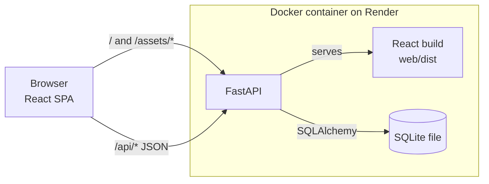
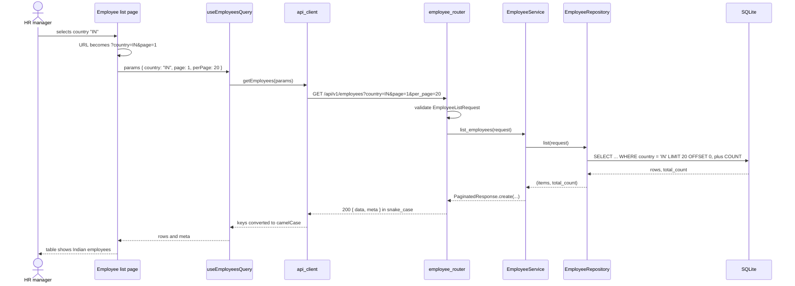
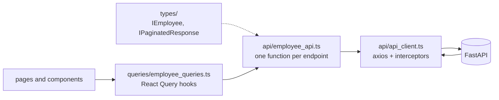
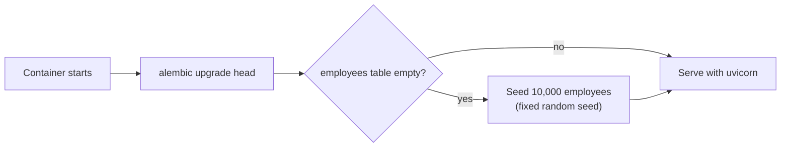

# Architecture

## 1. Overview

One web app for one HR manager. A React single-page app (TypeScript, Vite, Mantine) talks to a FastAPI backend over a JSON API under `/api/v1`. The backend stores employees in SQLite and computes salary insights with SQL aggregation. In production, both run in **one Docker container on Render**: FastAPI serves the built React files and the API from the same origin. On startup the container migrates the database and seeds 10,000 employees if it is empty. Salaries are annual base pay in each country's local currency; figures that add up several countries are converted to USD at fixed rates (decision 4).

## 2. System



| Path | Served as |
|---|---|
| `/api/v1/*` | The API (registered first, so nothing can shadow it). Unknown paths return a JSON 404 |
| `/api/health` | Health check for Render: `SELECT 1`, then `200` |
| `/assets/*` | Hashed static files, cached for a year. A missing file returns a plain 404 |
| Anything else | `index.html` with `no-cache`, so React Router handles the route |

In local development, Vite serves the frontend and FastAPI serves only the API.

## 3. Backend layers

| Layer | Job |
|---|---|
| Router | Declares the route, validates input with a request schema, calls one service method, returns a resource schema |
| Service | Business rules (e.g. unique email, employee exists), raises domain exceptions, owns the transaction |
| Repository | Queries: filtering, sorting, pagination and `GROUP BY` aggregation |
| Model | Table columns, indexes and constraints only |

Domain exceptions map to the `{ "error": ... }` shape in one place (`core/exception_handlers.py`). Endpoints are plain `def`, because SQLAlchemy with SQLite is synchronous.

**HR manager filters employees by country:**



## 4. Data model

**`employees`**

| Column | Type | Constraints |
|---|---|---|
| `id` | Integer | Primary key |
| `full_name` | String | Not null, trimmed, not empty |
| `email` | String | Not null, **unique among active employees**, stored lowercase |
| `job_title` | String | Not null, from the allowed list (`JobTitle` in `constants/employee_constants.py`) |
| `department` | String | Not null, from the allowed list (`Department`) |
| `country` | String(2) | Not null, ISO 3166-1 alpha-2, uppercase, from the allowed list |
| `salary` | Numeric(12, 2) | Not null, greater than 0, annual, in the country's currency (no currency column: the country sets it) |
| `hire_date` | Date | Not null |
| `is_active` | Boolean | Not null, default true. False = deleted (soft delete); hidden from every query |
| `created_at`, `updated_at` | DateTime | Not null, IST (UTC+05:30), set by the database layer |

| Index | Reason |
|---|---|
| `email` (unique where `is_active = 1`) | Guarantees no two active employees share an email, while a deleted employee's email can be reused; also serves the duplicate-email check |
| `full_name` | Default sort of the list (A–Z by name, ignoring case: the column is `COLLATE NOCASE`, which folds only A–Z, so an accented first letter like `É` still sorts after `Z`) |
| `country` | Country filter and per-country insights (`GROUP BY country`) |
| `job_title` | Job title filter |
| `department` | Department filter and per-department insights |
| `hire_date` | Sorting the list by hire date |
| `(country, job_title)` | Average salary per job title within a country, and the two filters combined |

**Login tables** (built last):

| Table | Columns |
|---|---|
| `users` | `id`, `email` (unique, lowercase), `password_hash` (Argon2), `created_at`, `updated_at` |
| `sessions` | `id`, `token_hash` (unique, SHA-256 of the cookie value), `user_id` (FK → `users`), `expires_at`, `created_at`, `updated_at` |

## 5. API outline

| Method and path | Purpose | Success |
|---|---|---|
| `GET /api/v1/employees` | List with `page`, `per_page`, `search` (part of the name or email, ignoring case), `country`, `job_title`, `department` (exact), `sort` (`field` or `-field`; any column below, default `full_name`) | 200 |
| `GET /api/v1/employees/{id}` | One employee | 200 |
| `POST /api/v1/employees` | Create | 201 |
| `PATCH /api/v1/employees/{id}` | Partial update | 200 |
| `DELETE /api/v1/employees/{id}` | Soft delete (sets `is_active` to false) | 204 |
| `GET /api/v1/salary-insights/overview` | Org headcount, total payroll in USD, and per country its headcount and payroll in its currency and in USD | 200 |
| `GET /api/v1/salary-insights/by-country` | Per country, in its currency: headcount, min, max, average and median salary; plus the average in USD | 200 |
| `GET /api/v1/salary-insights/by-job-title?country=IN` | Per job title within one country (required): headcount and average salary, in that country's currency | 200 |
| `GET /api/v1/salary-insights/by-department` | Per department: headcount and average salary in USD (a department spans countries) | 200 |
| `POST /api/v1/auth/login` | Log in, set the session cookie | 200 |
| `POST /api/v1/auth/logout` | Log out, delete the session | 204 |
| `GET /api/v1/auth/me` | Current user | 200 |
| `GET /api/health` | Health check | 200 |

Errors: 401 not logged in, 404 not found, 409 duplicate email (with `details` naming the `email` field), 422 validation, 429 too many login attempts, 500 generic message.

**Success:**
```json
{ "data": { "id": 1, "full_name": "Asha Rao", "email": "asha.rao@acme.com", "job_title": "Engineer", "department": "Engineering", "country": "IN", "salary": "85000.00", "hire_date": "2024-03-18" } }
```

**Paginated:**
```json
{
  "data": [ { "id": 1, "full_name": "Asha Rao", "salary": "85000.00" } ],
  "meta": { "total_count": 10000, "current_page": 1, "per_page": 20, "total_pages": 500 }
}
```

**Error:**
```json
{ "error": "Validation failed", "details": [ { "field": "salary", "message": "Salary must be greater than 0" } ] }
```

## 6. Frontend

| Page | Purpose |
|---|---|
| Employee list | Search, filter, sort and page through employees; add and edit in a modal with one shared form, with server field errors shown on the inputs (decision 22); delete with confirmation |
| Salary insights | Tables and stat cards for each insight |
| Login | Built last |

Every page is lazy-loaded behind a route boundary (error boundary + skeleton). List state (page, filters, search, sort) lives in the URL.



**Case conversion happens once, in the `api_client.ts` interceptors.** Requests: camelCase keys and query params → snake_case. Responses: snake_case → camelCase. Errors become `IApiError`, with `details[].field` converted too, so it matches the form field name. Money stays a decimal string and is only formatted (USD), never calculated, on the frontend.

## 7. Startup



Render's free tier has no persistent disk, so the database is recreated, and the seed runs again, on every restart. Edits made in the demo are lost when it restarts.

The steps live in `api/scripts/start.sh`, the image's start command. With `TRUST_FORWARDED_FOR=true` (set on Render), the login rate limit reads the caller's IP from the last `X-Forwarded-For` entry, the one Render's proxy appended, not from uvicorn's `--proxy-headers`, which trusts the client-written first entry (decision 23).

## Open questions

| # | Question |
|---|---|
| 1 | ~~Create and edit: separate routes or modals on the list page? Does "view" need its own detail page?~~ **Answered:** modals on the list page, no detail page (decision 22) |
| 2 | ~~Insights endpoints: one per insight or combined?~~ **Answered:** one endpoint per insight, each an array of objects (the overview an object holding one); see the API outline and decision 19 |
| 3 | ~~Job title, department and country: fixed lists or free text?~~ **Answered:** fixed lists in `constants/employee_constants.py`, matched ignoring case (decision 17); the web app loads them for its dropdowns from `GET /api/v1/employee-options` (decision 21) |
| 4 | ~~Sort allow-list?~~ **Answered:** every column shown in the table: `full_name`, `email`, `job_title`, `department`, `country`, `salary`, `hire_date`; ties broken by `id` |
| 5 | ~~Search by name or email uses a substring match, which can't use an index. Is a scan of 10,000 rows fast enough?~~ **Answered:** yes: 40 to 58 ms median, well under the 300 ms target (`docs/performance.md`) |
| 6 | ~~The `country` index duplicates the leading column of `(country, job_title)`. Keep both, or drop it?~~ **Answered:** keep both. Without it the planner falls back to the composite, and the country filter and the insights get 4 to 9 ms slower (`docs/performance.md`) |
| 7 | ~~Delete: hard or soft?~~ **Answered:** soft delete with `is_active` (decision 16) |
| 8 | ~~Login rate limit: in memory (resets on restart, fine for one container) or a database table?~~ **Answered:** in memory (decision 23) |
| 9 | ~~Seed data: values and salary ranges?~~ **Answered:** the fixed lists; each job title has a USD range and a department, scaled by a per-country pay factor (decision 18) |
